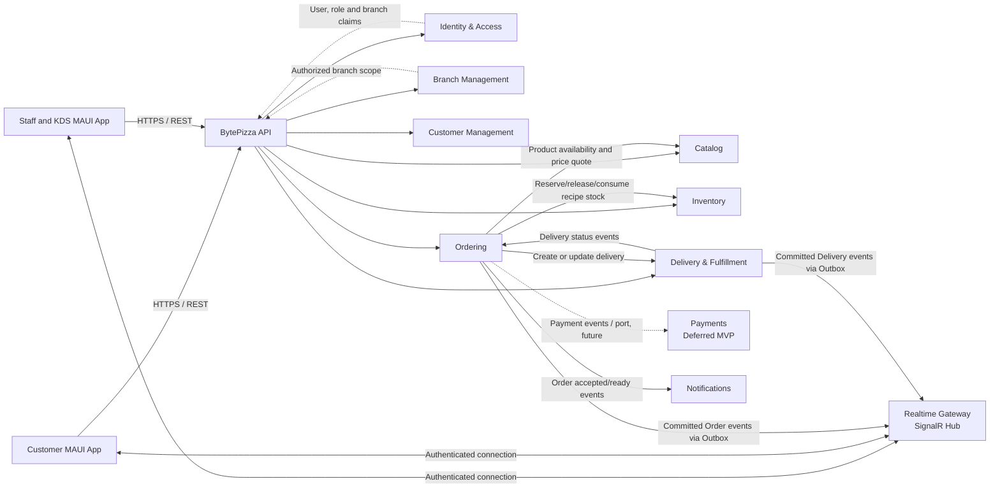

# BytePizza — Architecture Blueprint

**Status:** Proposed  
**Date:** 2026-10-22  
**Source:** [`00-po-specification.md`](./00-po-specification.md)

## 1. Scope and architectural baseline

BytePizza starts as a modular monolith for multiple branches. Its backend is a versioned REST API, backed by SQL Server, with SignalR for operational updates. The MAUI clients are online-only and separate customer-facing journeys from staff/KDS workflows. A single deployment and database keep the initial operational and transactional model simple; modules own their domain rules and tables.

### Decisions carried from the product specification

- Support multiple branches from the first release. `BranchId` is mandatory on branch-owned operational data. Branch is not synonymous with a SaaS tenant.
- Use SQL Server as the production database provider.
- Calculate weighted flavor prices on the server and store price snapshots on the order.
- Reserve recipe ingredients when an order is confirmed; consume them when preparation begins, subject to the final stock policy.
- Keep payment gateway integration out of the MVP.
- Require a live API connection to create and operate orders; no offline order synchronization.
- Restrict every staff operation to authorized branches. Customers can only access their own orders.
- Use an outbox for events that must not be lost. SignalR is a delivery mechanism, not the source of truth.

### Runtime version conflict

The source specification recommends .NET 10, while the requested ADR explicitly mentions .NET 9. This blueprint records .NET 9 as evaluated but rejected: its support ends on 2026-05-12, before this blueprint's date. The API and MAUI clients should target .NET 10, subject to verifying the required MAUI workloads and dependencies before implementation.

## 2. Bounded Contexts and dependencies

Arrows represent compile-time/application calls or published integration events. Contexts do not read or write another context's tables directly. The initial deployment may share one SQL Server database, but schema/table ownership remains explicit.



### Context responsibilities and ownership

| Bounded Context        | Owns                                                                                                   | Important boundary                                                                                                                  |
| ---------------------- | ------------------------------------------------------------------------------------------------------ | ----------------------------------------------------------------------------------------------------------------------------------- |
| Identity & Access      | Staff identities, credentials, roles, permissions, refresh-token lifecycle                             | Customer identity may use a separate account policy; never expose staff claims to customer clients.                                 |
| Branch Management      | Branches, operational configuration, branch membership/authorization                                   | Does not own orders, stock, or branch-specific catalog prices.                                                                      |
| Catalog                | Products, sizes, flavors, edges, add-ons, recipes' sellable configuration, branch price/availability   | Exposes a pricing/availability query contract; Order stores a snapshot rather than a live product reference for historical pricing. |
| Customer Management    | Customer profiles, contact information, addresses and consent                                          | Ordering stores customer ID and delivery-address snapshot; it does not depend on mutable address data after placement.              |
| Ordering               | Order aggregate, item/options snapshots, totals, state transitions, order history, idempotency records | Owns order lifecycle. Commands validate transitions and do not accept client-supplied prices.                                       |
| Inventory              | Ingredients, units, recipes, branch stock balances, reservations, movements and adjustments            | Owns stock consistency and reservations; no other context updates balances directly.                                                |
| Delivery & Fulfillment | Delivery assignment, driver, dispatch and delivery lifecycle                                           | Owns delivery state separately from order state; communicates completion to Ordering through an application port/event.             |
| Payments               | Payment attempts and payment state                                                                     | Deferred from MVP; keep a seam, not a prematurely implemented gateway abstraction.                                                  |
| Notifications          | Customer/staff notification delivery                                                                   | Consumes committed events; delivery failure must not roll back an already committed order.                                          |

### Cross-context consistency

- Order confirmation and inventory reservation must be atomic in the initial modular monolith. Coordinate through an application-level inventory port and one local database transaction; do not call remote services from inside that transaction.
- Persist the order changes and outbox records in the same transaction. Publish outbox messages asynchronously after commit.
- SignalR notifications may be delayed or duplicated. Clients should de-duplicate by event ID and re-query the REST API after reconnecting.
- If contexts are split into separate services/databases later, replace local atomicity with an explicit saga/compensation policy; do not assume a distributed transaction.

## 3. Domain and application contracts

The contracts below are the initial persistence/application boundary. Domain repository interfaces live with their consuming domain aggregates. `IUnitOfWork` is an Application abstraction. Infrastructure implements these contracts with EF Core and SQL Server; EF Core types do not leak into Domain or Application.

```csharp
// BytePizza.Domain/Orders/IOrderRepository.cs
namespace BytePizza.Domain.Orders;

public interface IOrderRepository
{
    Task<Order?> GetByIdAsync(Guid orderId, CancellationToken cancellationToken);

    Task AddAsync(Order order, CancellationToken cancellationToken);
}
```

```csharp
// BytePizza.Domain/Catalog/IProductRepository.cs
namespace BytePizza.Domain.Catalog;

public interface IProductRepository
{
    Task<Product?> GetAvailableForSaleAsync(
        Guid branchId,
        Guid productId,
        CancellationToken cancellationToken);
}
```

```csharp
// BytePizza.Domain/Customers/ICustomerRepository.cs
namespace BytePizza.Domain.Customers;

public interface ICustomerRepository
{
    Task<Customer?> GetByIdAsync(Guid customerId, CancellationToken cancellationToken);

    Task<bool> ExistsAsync(Guid customerId, CancellationToken cancellationToken);
}
```

```csharp
// BytePizza.Domain/Inventory/IInventoryRepository.cs
namespace BytePizza.Domain.Inventory;

public interface IInventoryRepository
{
    Task<StockBalance?> GetBalanceAsync(
        Guid branchId,
        Guid ingredientId,
        CancellationToken cancellationToken);

    Task AddMovementAsync(StockMovement movement, CancellationToken cancellationToken);

    Task AddReservationAsync(StockReservation reservation, CancellationToken cancellationToken);

    Task<StockReservation?> GetReservationForOrderAsync(
        Guid branchId,
        Guid orderId,
        CancellationToken cancellationToken);
}
```

```csharp
// BytePizza.Application/Common/Persistence/IUnitOfWork.cs
namespace BytePizza.Application.Common.Persistence;

public interface IUnitOfWork
{
    Task<int> SaveChangesAsync(CancellationToken cancellationToken);

    Task<TResult> ExecuteInTransactionAsync<TResult>(
        Func<CancellationToken, Task<TResult>> operation,
        CancellationToken cancellationToken);
}
```

```csharp
// BytePizza.Application/Orders/Queries/IOrderQueries.cs
namespace BytePizza.Application.Orders.Queries;

using BytePizza.Application.Orders.Contracts;

public interface IOrderQueries
{
    Task<CreateOrderResponse?> GetByIdAsync(
        Guid branchId,
        Guid orderId,
        CancellationToken cancellationToken);

    Task<OrderListResponse> ListAsync(
        Guid branchId,
        OrderStatus? status,
        string? cursor,
        CancellationToken cancellationToken);
}
```

`ExecuteInTransactionAsync` is for database work only. It must use the provider execution strategy correctly, commit tracked changes and outbox records atomically, and must not contain network calls or SignalR sends. `IOrderRepository` is for aggregate operations in commands; `IOrderQueries` is implemented with read-only, `AsNoTracking` projections directly to DTOs.

Additional application ports expected in the implementation:

```csharp
namespace BytePizza.Application.Orders;

public interface IBranchAccessService
{
    Task<bool> CanAccessAsync(
        Guid userId,
        Guid branchId,
        CancellationToken cancellationToken);
}

public interface IInventoryReservationService
{
    Task ReserveForOrderAsync(
        Guid branchId,
        Guid orderId,
        CancellationToken cancellationToken);

    Task ConsumeForOrderAsync(
        Guid branchId,
        Guid orderId,
        CancellationToken cancellationToken);

    Task ReleaseForOrderAsync(
        Guid branchId,
        Guid orderId,
        CancellationToken cancellationToken);
}
```

The reservation service is an application boundary implemented by the Inventory module. Its implementation participates in the same local unit of work for order confirmation. Repositories should expose aggregate persistence, not generic CRUD for every entity.

## 4. Order HTTP API and OpenAPI contract

### Order flow

1. The client requests an order with product IDs, options, and quantities; it never supplies authoritative unit prices or totals.
2. The API resolves the authenticated customer/staff identity and authorized branch.
3. Ordering obtains current branch availability and server-side prices from Catalog, validates flavor fractions, and builds immutable price snapshots.
4. On confirmation, Ordering reserves recipe stock in the same local transaction. Insufficient stock fails without a partial reservation.
5. The API persists the order, history, idempotency result, and outbox event. Only after commit does the publisher notify SignalR clients.
6. KDS and customer clients use REST to recover authoritative state after disconnect/reconnect.

### Routes

| Method | Route                                                               | Purpose                                                  | Success                          |
| ------ | ------------------------------------------------------------------- | -------------------------------------------------------- | -------------------------------- |
| `POST` | `/api/v1/branches/{branchId}/orders`                                | Create and confirm an order                              | `201 Created`, `Location` header |
| `GET`  | `/api/v1/branches/{branchId}/orders/{orderId}`                      | Get order detail, scoped to customer or authorized staff | `200 OK`                         |
| `GET`  | `/api/v1/branches/{branchId}/orders?status=&after=&before=&cursor=` | KDS/staff order list; customer list is self-scoped       | `200 OK`                         |
| `POST` | `/api/v1/branches/{branchId}/orders/{orderId}/transitions`          | Apply an allowed lifecycle transition                    | `200 OK`                         |

Create requires an `Idempotency-Key` header (UUID). Repeating the same key and same request returns the original result; reusing it for a different request returns `409 Conflict`. Transition requests include the expected order version to detect concurrent updates.

### DTO contracts

```csharp
namespace BytePizza.Application.Orders.Contracts;

public sealed record CreateOrderRequest(
    Guid? CustomerId,
    OrderType OrderType,
    Guid? AddressId,
    string? DeliveryAddressSnapshot,
    Guid? TableId,
    string? Notes,
    IReadOnlyList<CreateOrderItemRequest> Items);

public sealed record CreateOrderItemRequest(
    Guid ProductId,
    Guid SizeId,
    int Quantity,
    Guid? EdgeId,
    IReadOnlyList<CreateOrderFlavorRequest> Flavors,
    IReadOnlyList<CreateOrderAddonRequest> Addons,
    string? Notes);

public sealed record CreateOrderFlavorRequest(
    Guid FlavorId,
    decimal Fraction);

public sealed record CreateOrderAddonRequest(
    Guid AddonId,
    int Quantity);

public sealed record CreateOrderResponse(
    Guid Id,
    string OrderNumber,
    Guid BranchId,
    OrderStatus Status,
    OrderType OrderType,
    decimal Subtotal,
    decimal DeliveryFee,
    decimal Discount,
    decimal Total,
    string Currency,
    DateTimeOffset CreatedAt,
    long Version,
    IReadOnlyList<OrderItemResponse> Items);

public sealed record OrderItemResponse(
    Guid Id,
    Guid ProductId,
    string ProductName,
    string SizeName,
    int Quantity,
    decimal UnitPrice,
    decimal TotalPrice,
    decimal? EdgePrice,
    IReadOnlyList<OrderFlavorResponse> Flavors,
    IReadOnlyList<OrderAddonResponse> Addons,
    string? Notes);

public sealed record OrderFlavorResponse(
    Guid FlavorId,
    string Name,
    decimal Fraction,
    decimal AppliedUnitPrice);

public sealed record OrderAddonResponse(
    Guid AddonId,
    string Name,
    int Quantity,
    decimal UnitPrice);

public sealed record ChangeOrderStatusRequest(
    OrderStatus TargetStatus,
    long ExpectedVersion,
    string? Reason);

public sealed record OrderStatusResponse(
    Guid OrderId,
    OrderStatus Status,
    long Version,
    DateTimeOffset ChangedAt);

public sealed record OrderListResponse(
    IReadOnlyList<OrderSummaryResponse> Items,
    string? NextCursor);

public sealed record OrderSummaryResponse(
    Guid Id,
    string OrderNumber,
    OrderType OrderType,
    OrderStatus Status,
    string? CustomerName,
    decimal Total,
    DateTimeOffset CreatedAt,
    long Version);

public enum OrderType
{
    Counter,
    DineIn,
    Delivery,
    Takeout
}

public enum OrderStatus
{
    Pending,
    Confirmed,
    Preparing,
    Ready,
    Completed,
    Canceled
}
```

The request's `DeliveryAddressSnapshot` is accepted only for a guest or where the caller is allowed to use the supplied address. Prefer resolving a stored `AddressId` for an authenticated customer, then copy a validated snapshot into the order. If the request contains both fields, define and validate precedence rather than silently selecting one. `TableId` is required for `DineIn`; `AddressId` or an approved guest address is required for `Delivery`; these conditional rules belong in application validation.

`UnitPrice`, `TotalPrice`, discounts, fees, and totals are response-only server calculations. `Fraction` values must be positive and sum exactly to `1.0000` within the configured precision. Weighted flavor price is `Σ(fraction × branch/size flavor price)`. Define the currency scale and rounding point centrally; do not round each flavor fraction independently in a way that changes the final sum.

### OpenAPI excerpt

```yaml
openapi: 3.1.0
info:
  title: BytePizza Orders API
  version: 1.0.0
servers:
  - url: https://api.bytepizza.example
paths:
  /api/v1/branches/{branchId}/orders:
    post:
      operationId: createOrder
      summary: Create and confirm an order
      security:
        - bearerAuth: []
      parameters:
        - $ref: "#/components/parameters/BranchId"
        - name: Idempotency-Key
          in: header
          required: true
          schema:
            type: string
            format: uuid
      requestBody:
        required: true
        content:
          application/json:
            schema:
              $ref: "#/components/schemas/CreateOrderRequest"
      responses:
        "201":
          description: Order created; Location points to the order resource
          headers:
            Location:
              required: true
              schema:
                type: string
                format: uri-reference
          content:
            application/json:
              schema:
                $ref: "#/components/schemas/CreateOrderResponse"
        "400":
          $ref: "#/components/responses/Problem"
        "401":
          $ref: "#/components/responses/Problem"
        "403":
          $ref: "#/components/responses/Problem"
        "404":
          $ref: "#/components/responses/Problem"
        "409":
          description: Idempotency conflict, concurrent update, or invalid state
          content:
            application/problem+json:
              schema:
                $ref: "#/components/schemas/ProblemDetails"
        "422":
          description: Business rule violation, including insufficient stock
          content:
            application/problem+json:
              schema:
                $ref: "#/components/schemas/ProblemDetails"
    get:
      operationId: listOrders
      summary: List orders visible to the authenticated caller
      security:
        - bearerAuth: []
      parameters:
        - $ref: "#/components/parameters/BranchId"
        - name: status
          in: query
          schema:
            $ref: "#/components/schemas/OrderStatus"
        - name: cursor
          in: query
          schema:
            type: string
      responses:
        "200":
          description: Page of authorized orders
          content:
            application/json:
              schema:
                $ref: "#/components/schemas/OrderListResponse"
        "401":
          $ref: "#/components/responses/Problem"
        "403":
          $ref: "#/components/responses/Problem"
  /api/v1/branches/{branchId}/orders/{orderId}:
    get:
      operationId: getOrder
      summary: Get an order visible to the authenticated caller
      security:
        - bearerAuth: []
      parameters:
        - $ref: "#/components/parameters/BranchId"
        - name: orderId
          in: path
          required: true
          schema:
            type: string
            format: uuid
      responses:
        "200":
          description: Order detail
          content:
            application/json:
              schema:
                $ref: "#/components/schemas/CreateOrderResponse"
        "401":
          $ref: "#/components/responses/Problem"
        "403":
          $ref: "#/components/responses/Problem"
        "404":
          $ref: "#/components/responses/Problem"
  /api/v1/branches/{branchId}/orders/{orderId}/transitions:
    post:
      operationId: changeOrderStatus
      summary: Apply an allowed order state transition
      security:
        - bearerAuth: []
      parameters:
        - $ref: "#/components/parameters/BranchId"
        - name: orderId
          in: path
          required: true
          schema:
            type: string
            format: uuid
      requestBody:
        required: true
        content:
          application/json:
            schema:
              $ref: "#/components/schemas/ChangeOrderStatusRequest"
      responses:
        "200":
          description: Transition applied
          content:
            application/json:
              schema:
                $ref: "#/components/schemas/OrderStatusResponse"
        "400":
          $ref: "#/components/responses/Problem"
        "401":
          $ref: "#/components/responses/Problem"
        "403":
          $ref: "#/components/responses/Problem"
        "404":
          $ref: "#/components/responses/Problem"
        "409":
          description: Invalid transition or stale expectedVersion
          content:
            application/problem+json:
              schema:
                $ref: "#/components/schemas/ProblemDetails"
components:
  securitySchemes:
    bearerAuth:
      type: http
      scheme: bearer
      bearerFormat: JWT
  parameters:
    BranchId:
      name: branchId
      in: path
      required: true
      schema:
        type: string
        format: uuid
  responses:
    Problem:
      description: RFC 9457 Problem Details response
      content:
        application/problem+json:
          schema:
            $ref: "#/components/schemas/ProblemDetails"
  schemas:
    CreateOrderRequest:
      type: object
      required: [orderType, items]
      properties:
        customerId:
          type: [string, "null"]
          format: uuid
        orderType:
          $ref: "#/components/schemas/OrderType"
        addressId:
          type: [string, "null"]
          format: uuid
        deliveryAddressSnapshot:
          type: [string, "null"]
        tableId:
          type: [string, "null"]
          format: uuid
        notes:
          type: [string, "null"]
          maxLength: 500
        items:
          type: array
          minItems: 1
          items:
            $ref: "#/components/schemas/CreateOrderItemRequest"
    CreateOrderItemRequest:
      type: object
      required: [productId, sizeId, quantity, flavors, addons]
      properties:
        productId:
          type: string
          format: uuid
        sizeId:
          type: string
          format: uuid
        quantity:
          type: integer
          minimum: 1
        edgeId:
          type: [string, "null"]
          format: uuid
        flavors:
          type: array
          minItems: 1
          items:
            $ref: "#/components/schemas/CreateOrderFlavorRequest"
        addons:
          type: array
          items:
            $ref: "#/components/schemas/CreateOrderAddonRequest"
        notes:
          type: [string, "null"]
    CreateOrderFlavorRequest:
      type: object
      required: [flavorId, fraction]
      properties:
        flavorId:
          type: string
          format: uuid
        fraction:
          type: number
          exclusiveMinimum: 0
          maximum: 1
    CreateOrderAddonRequest:
      type: object
      required: [addonId, quantity]
      properties:
        addonId:
          type: string
          format: uuid
        quantity:
          type: integer
          minimum: 1
    CreateOrderResponse:
      type: object
      required:
        [
          id,
          orderNumber,
          branchId,
          status,
          orderType,
          subtotal,
          total,
          currency,
          createdAt,
          version,
          items,
        ]
      properties:
        id:
          type: string
          format: uuid
        orderNumber:
          type: string
        branchId:
          type: string
          format: uuid
        status:
          $ref: "#/components/schemas/OrderStatus"
        orderType:
          $ref: "#/components/schemas/OrderType"
        subtotal:
          type: number
          format: decimal
        deliveryFee:
          type: number
          format: decimal
        discount:
          type: number
          format: decimal
        total:
          type: number
          format: decimal
        currency:
          type: string
          example: BRL
        createdAt:
          type: string
          format: date-time
        version:
          type: integer
          format: int64
        items:
          type: array
          items:
            $ref: "#/components/schemas/OrderItemResponse"
    OrderItemResponse:
      type: object
      required:
        [
          id,
          productId,
          productName,
          sizeName,
          quantity,
          unitPrice,
          totalPrice,
          flavors,
          addons,
        ]
      properties:
        id:
          type: string
          format: uuid
        productId:
          type: string
          format: uuid
        productName:
          type: string
        sizeName:
          type: string
        quantity:
          type: integer
        unitPrice:
          type: number
          format: decimal
        totalPrice:
          type: number
          format: decimal
        edgePrice:
          type: [number, "null"]
          format: decimal
        flavors:
          type: array
          items:
            $ref: "#/components/schemas/OrderFlavorResponse"
        addons:
          type: array
          items:
            $ref: "#/components/schemas/OrderAddonResponse"
        notes:
          type: [string, "null"]
    OrderFlavorResponse:
      type: object
      required: [flavorId, name, fraction, appliedUnitPrice]
      properties:
        flavorId:
          type: string
          format: uuid
        name:
          type: string
        fraction:
          type: number
        appliedUnitPrice:
          type: number
          format: decimal
    OrderAddonResponse:
      type: object
      required: [addonId, name, quantity, unitPrice]
      properties:
        addonId:
          type: string
          format: uuid
        name:
          type: string
        quantity:
          type: integer
        unitPrice:
          type: number
          format: decimal
    ChangeOrderStatusRequest:
      type: object
      required: [targetStatus, expectedVersion]
      properties:
        targetStatus:
          $ref: "#/components/schemas/OrderStatus"
        expectedVersion:
          type: integer
          format: int64
        reason:
          type: [string, "null"]
    OrderStatusResponse:
      type: object
      required: [orderId, status, version, changedAt]
      properties:
        orderId:
          type: string
          format: uuid
        status:
          $ref: "#/components/schemas/OrderStatus"
        version:
          type: integer
          format: int64
        changedAt:
          type: string
          format: date-time
    OrderListResponse:
      type: object
      required: [items]
      properties:
        items:
          type: array
          items:
            $ref: "#/components/schemas/OrderSummaryResponse"
        nextCursor:
          type: [string, "null"]
    OrderSummaryResponse:
      type: object
      required: [id, orderNumber, orderType, status, total, createdAt, version]
      properties:
        id:
          type: string
          format: uuid
        orderNumber:
          type: string
        orderType:
          $ref: "#/components/schemas/OrderType"
        status:
          $ref: "#/components/schemas/OrderStatus"
        customerName:
          type: [string, "null"]
        total:
          type: number
          format: decimal
        createdAt:
          type: string
          format: date-time
        version:
          type: integer
          format: int64
    OrderType:
      type: string
      enum: [Counter, DineIn, Delivery, Takeout]
    OrderStatus:
      type: string
      enum: [Pending, Confirmed, Preparing, Ready, Completed, Canceled]
    ProblemDetails:
      type: object
      required: [type, title, status]
      properties:
        type:
          type: string
          format: uri
        title:
          type: string
        status:
          type: integer
        detail:
          type: string
        instance:
          type: string
          format: uri-reference
        traceId:
          type: string
        errors:
          type: object
          additionalProperties:
            type: array
            items:
              type: string
```

### HTTP error mapping

- `400 Bad Request`: malformed payload or failed structural validation.
- `401 Unauthorized`: missing/invalid authentication.
- `403 Forbidden`: authenticated caller lacks branch/operation permission.
- `404 Not Found`: resource does not exist or is intentionally concealed by access policy.
- `409 Conflict`: stale order version, invalid lifecycle transition, or idempotency-key reuse with a different payload.
- `422 Unprocessable Content`: valid request that violates business rules, such as unavailable item, invalid flavor composition, or insufficient stock.
- `application/problem+json`: standardized Problem Details body. Use RFC 9457-compatible ASP.NET Core ProblemDetails while preserving the required response shape.

## 5. Solution project and folder tree

Use one backend project per architectural layer, with bounded contexts as first-class folders. This preserves the referenced prompt's four backend projects while avoiding a single undifferentiated `Services` folder. The two MAUI applications share only client-side presentation/API abstractions, not UI workflows.

```text
BytePizza/
├── BytePizza.slnx
├── Directory.Build.props
├── Directory.Packages.props
├── global.json
├── README.md
├── docs/
│   ├── 00-po-specification.md
│   ├── 01-architecture-blueprint.md
│   └── adr/
│       ├── 0001-dotnet-version.md
│       ├── 0002-sql-server.md
│       ├── 0003-signalr-realtime.md
│       └── 0004-ci-cd.md
├── .github/
│   └── workflows/
│       ├── ci-api.yml
│       ├── ci-mobile-android.yml
│       └── ci-client-windows.yml
├── src/
│   ├── BytePizza.Domain/
│   │   ├── Common/
│   │   │   ├── Entity.cs
│   │   │   ├── ValueObject.cs
│   │   │   └── IDomainEvent.cs
│   │   ├── Branches/
│   │   │   ├── Branch.cs
│   │   │   └── IBranchRepository.cs
│   │   ├── Catalog/
│   │   │   ├── Product.cs
│   │   │   ├── Flavor.cs
│   │   │   ├── Edge.cs
│   │   │   ├── ProductSize.cs
│   │   │   └── IProductRepository.cs
│   │   ├── Customers/
│   │   │   ├── Customer.cs
│   │   │   ├── Address.cs
│   │   │   └── ICustomerRepository.cs
│   │   ├── Orders/
│   │   │   ├── Order.cs
│   │   │   ├── OrderItem.cs
│   │   │   ├── OrderFlavor.cs
│   │   │   ├── OrderStatus.cs
│   │   │   ├── OrderType.cs
│   │   │   ├── Money.cs
│   │   │   ├── OrderPlacedDomainEvent.cs
│   │   │   └── IOrderRepository.cs
│   │   ├── Inventory/
│   │   │   ├── Ingredient.cs
│   │   │   ├── Recipe.cs
│   │   │   ├── StockBalance.cs
│   │   │   ├── StockReservation.cs
│   │   │   ├── StockMovement.cs
│   │   │   └── IInventoryRepository.cs
│   │   └── Fulfillment/
│   │       ├── Delivery.cs
│   │       ├── DeliveryStatus.cs
│   │       └── IDeliveryRepository.cs
│   ├── BytePizza.Application/
│   │   ├── Common/
│   │   │   ├── Behaviors/
│   │   │   ├── Errors/
│   │   │   ├── Persistence/IUnitOfWork.cs
│   │   │   └── Results/Result.cs
│   │   ├── Branches/
│   │   │   ├── Contracts/
│   │   │   └── Queries/
│   │   ├── Catalog/
│   │   │   ├── Contracts/
│   │   │   ├── Queries/
│   │   │   └── Validators/
│   │   ├── Customers/
│   │   │   ├── Contracts/
│   │   │   ├── Commands/
│   │   │   └── Queries/
│   │   ├── Orders/
│   │   │   ├── Contracts/
│   │   │   ├── Commands/CreateOrder/
│   │   │   ├── Commands/ChangeOrderStatus/
│   │   │   ├── Queries/GetOrder/
│   │   │   ├── Queries/ListOrders/
│   │   │   ├── Ports/IBranchAccessService.cs
│   │   │   ├── Ports/IInventoryReservationService.cs
│   │   │   └── Validators/
│   │   ├── Inventory/
│   │   │   ├── Contracts/
│   │   │   ├── Commands/
│   │   │   └── Queries/
│   │   └── Fulfillment/
│   │       ├── Contracts/
│   │       ├── Commands/
│   │       └── Queries/
│   ├── BytePizza.Infrastructure/
│   │   ├── DependencyInjection.cs
│   │   ├── Persistence/
│   │   │   ├── BytePizzaDbContext.cs
│   │   │   ├── Configurations/
│   │   │   ├── Migrations/
│   │   │   ├── Repositories/
│   │   │   └── UnitOfWork.cs
│   │   ├── Identity/
│   │   ├── Realtime/
│   │   ├── Outbox/
│   │   ├── Observability/
│   │   └── Resilience/
│   ├── BytePizza.Api/
│   │   ├── BytePizza.Api.csproj
│   │   ├── Program.cs
│   │   ├── Endpoints/
│   │   │   ├── Orders/
│   │   │   ├── Catalog/
│   │   │   ├── Customers/
│   │   │   ├── Inventory/
│   │   │   └── Fulfillment/
│   │   ├── Hubs/OrderUpdatesHub.cs
│   │   ├── Authorization/
│   │   ├── Middleware/
│   │   ├── OpenApi/
│   │   └── Configuration/
│   ├── BytePizza.Client.Shared/
│   │   ├── Api/
│   │   ├── Authentication/
│   │   ├── Navigation/
│   │   ├── Localization/
│   │   └── Validation/
│   ├── BytePizza.Client.Customer/
│   │   ├── BytePizza.Client.Customer.csproj
│   │   ├── App.xaml
│   │   ├── Views/
│   │   ├── ViewModels/
│   │   ├── Models/
│   │   └── Resources/
│   └── BytePizza.Client.Staff/
│       ├── BytePizza.Client.Staff.csproj
│       ├── App.xaml
│       ├── Views/
│       ├── ViewModels/
│       ├── Kds/
│       ├── Models/
│       └── Resources/
└── tests/
    ├── BytePizza.Domain.UnitTests/
    ├── BytePizza.Application.UnitTests/
    ├── BytePizza.Infrastructure.IntegrationTests/
    ├── BytePizza.Api.IntegrationTests/
    └── BytePizza.ArchitectureTests/
```

### Dependency direction

```text
BytePizza.Domain       -> no project/framework dependencies
BytePizza.Application  -> BytePizza.Domain
BytePizza.Infrastructure -> BytePizza.Application + BytePizza.Domain
BytePizza.Api          -> BytePizza.Application + BytePizza.Infrastructure (composition root only)
BytePizza.Client.*     -> BytePizza.Client.Shared (no reference to backend projects)
Tests                  -> projects under test
```

Do not make the API depend on Infrastructure types outside `Program.cs` composition. Client request/response contracts should be generated from OpenAPI or maintained as client-owned contracts; the MAUI client must not reference the server Application project.

## 6. Realtime contract

Expose an authenticated hub at `/hubs/order-updates`. The server derives allowed branch and customer groups from validated identity claims and authorization services; clients must not be allowed to join arbitrary group names.

Suggested server-to-client events:

```text
OrderChanged(OrderChangedEvent)
DeliveryChanged(DeliveryChangedEvent)
```

`OrderChangedEvent` contains `eventId`, `branchId`, `orderId`, `orderNumber`, `status`, `version`, and `occurredAt`. It must not contain payment credentials, full address details, or unnecessary customer PII. The client compares `version` to its last known version and fetches the REST resource if it detects a gap. Publish only after the database transaction commits, preferably by consuming the persisted outbox.

## 7. Architectural Decision Records

### ADR-0001 — .NET target framework

- **Status:** Accepted — target .NET 10; .NET 9 rejected.
- **Context:** The request names .NET 9, while the source product specification recommends .NET 10. .NET 9 support ended on 2026-05-12; the design date is 2026-10-22. MAUI targets also need a supported SDK/workload pairing.
- **Decision:** Target `net10.0` for API and shared backend projects and the corresponding .NET MAUI 10 target frameworks. Pin the SDK via `global.json` to an installed, supported .NET 10 SDK. Verify third-party package and platform workload compatibility before implementation.
- **Consequences:** Avoids starting on an unsupported runtime and aligns API, mobile clients, and CI. If deployment policy mandates .NET 9, this ADR must be explicitly superseded and the product owner must accept the unsupported-runtime risk; do not silently mix API .NET 9 with MAUI .NET 10.

### ADR-0002 — SQL Server as production database

- **Status:** Accepted.
- **Context:** SQL Server was selected in the product decisions. Initial ordering and inventory confirmation needs local transactional consistency.
- **Decision:** Use EF Core with the SQL Server provider and one production database for the modular monolith. Keep schema/table ownership per context, enforce branch scoping in application/query boundaries, and use SQL Server concurrency support (for example `rowversion`) for stock balances and order versions. Integration tests must run against SQL Server, not rely solely on an in-memory provider.
- **Consequences:** Provider-specific features and migrations are authoritative. Do not claim PostgreSQL support unless it is separately implemented and tested. Cross-context confirmation is an explicit local transaction; all external notifications use outbox publication after commit.

### ADR-0003 — SignalR for operational realtime updates

- **Status:** Accepted.
- **Context:** Staff KDS and customer tracking need prompt updates, but REST remains the authoritative order interface.
- **Decision:** Use ASP.NET Core SignalR for push updates. Authenticate connections, authorize branch/customer subscriptions server-side, publish committed domain integration events through an outbox, and expose REST resynchronization after reconnect.
- **Consequences:** SignalR delivery is treated as at-least-once/best-effort from the client's perspective; events are versioned and de-duplicated. If deployment scales beyond one API instance, configure a supported SignalR backplane or managed service. Do not broadcast sensitive data to branch-wide groups.

### ADR-0004 — CI/CD by workload and target platform

- **Status:** Accepted.
- **Context:** API, Android MAUI, and Windows KDS have different SDK/workload and runner requirements; one Ubuntu API build cannot validate the Windows client.
- **Decision:** Use GitHub Actions with separate jobs/workflows: Linux for restore, format/analyzers, API build and tests; SQL Server-backed integration tests in CI; a compatible Android runner for MAUI Android build; and Windows runner for Windows client/KDS build. Trigger pull requests and pushes according to the agreed `develop` and `feature/**` workflow. Pin SDK/workload setup and use lock files where practical.
- **Consequences:** CI time and runner costs increase, but each deliverable is built on a supported platform. Keep secrets in GitHub environments, restrict deployment to protected branches/tags, build once and promote artifacts, and never deploy from untrusted pull-request code. Add deployment/release jobs only after hosting targets and environments are selected.

## 8. Implementation handoff and open decisions

### Recommended implementation order

1. Create projects, target frameworks, project references, architecture tests, SDK pinning, and baseline CI.
2. Implement Identity/Branch authorization and Catalog branch availability/pricing.
3. Implement Order aggregates, server-side weighted pricing, idempotent creation, and the status state machine.
4. Implement Inventory recipes/reservations and transactional confirmation.
5. Add outbox publication, SignalR KDS/customer updates, and reconnect resynchronization.
6. Add Delivery/Fulfillment workflows and separate customer/staff MAUI flows.

### Decisions still required before freezing contracts

- Is catalog pricing centrally managed with branch overrides, or fully managed per branch?
- Can customers check out as guests, or is account creation mandatory?
- Should the MVP record external/manual payments even though gateway integration is deferred?
- Confirm whether canceling after preparation begins releases stock automatically or requires an adjustment.
- Define delivery fees, discounts, currency rounding precision, flavor-count limits per size, and table/session behavior.
- Define expected concurrent order volume, availability target, hosting provider, and deployment environments.

### Handoff

The blueprint is ready for implementation planning. The Coder should implement the project skeleton and order contracts from this document; the Tester should derive domain, application, SQL Server integration, and API contract tests; the Reviewer should validate authorization isolation, transaction boundaries, idempotency, and SignalR group access before release.
